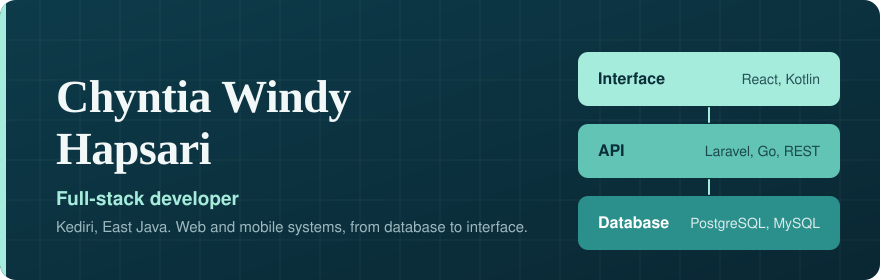
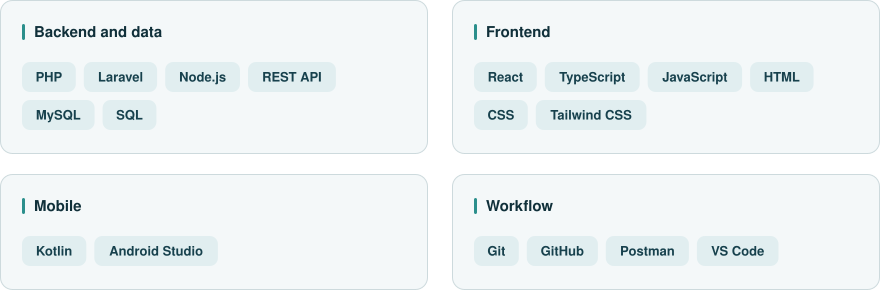
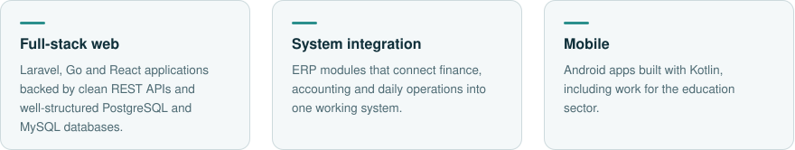

  

  &nbsp;&nbsp;
  &nbsp;&nbsp;
  

## About

I build web and mobile applications that sit on top of solid databases. My work covers Laravel, Go and React on the web, Kotlin on Android, and the REST APIs that connect them, with PostgreSQL and MySQL underneath.

I graduated with a D3 in Informatics Management from Politeknik Negeri Malang (Kediri campus). Most of my work lives in private repositories, so this profile shows the tools I use and the kind of problems I work on.

## Tech stack

## What I work on

## Experience

| Period | Role |
|:--|:--|
| Jul&nbsp;2026&nbsp;–&nbsp;Oct&nbsp;2026 | **Web Developer (contract)**, PT Nusatama Jaya Sakti Built a TypeScript ERP that integrates trading, clinic, laboratory and pharmacy operations. |
| Jun&nbsp;2025&nbsp;–&nbsp;Dec&nbsp;2025 | **Web Developer (intern)**, PT Nusatama Jaya Sakti Built web applications with PHP and React, finance and accounting modules, and a mobile app for education. |
| Aug&nbsp;2023&nbsp;–&nbsp;Aug&nbsp;2026 | **D3 Informatics Management**, Politeknik Negeri Malang, Kediri campus |

## Get in touch

I'm open to full-stack and web developer roles. The quickest way to reach me is [email](mailto:chyntiawindyh@gmail.com), or send a note on [LinkedIn](https://www.linkedin.com/in/chyntiawindyhapsari/).
